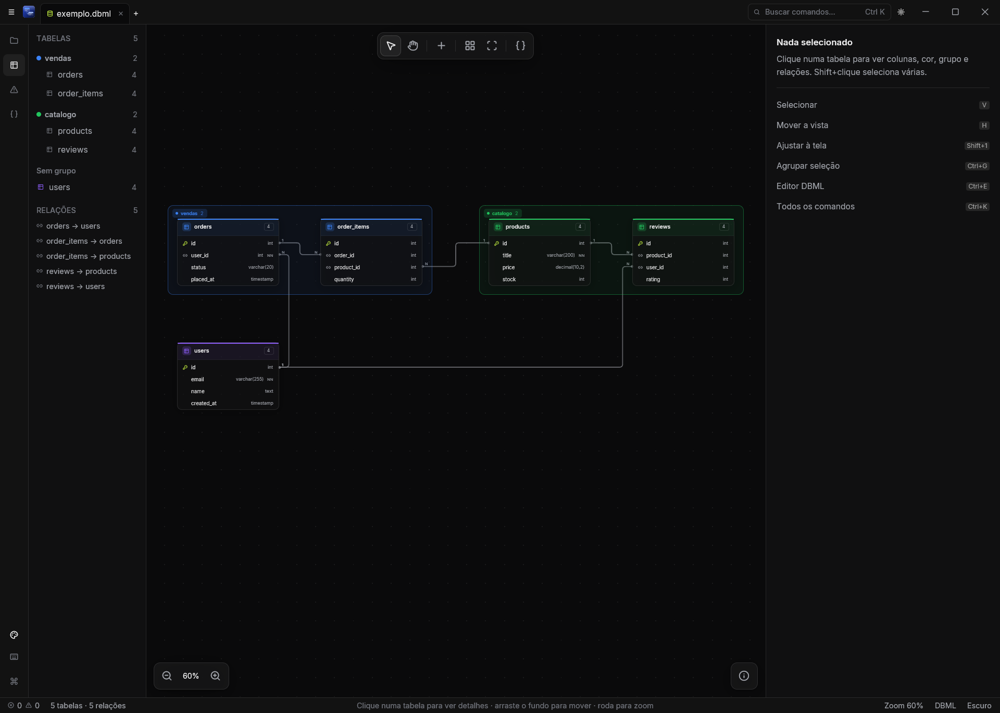
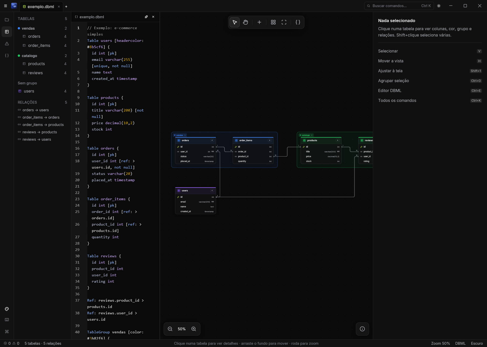
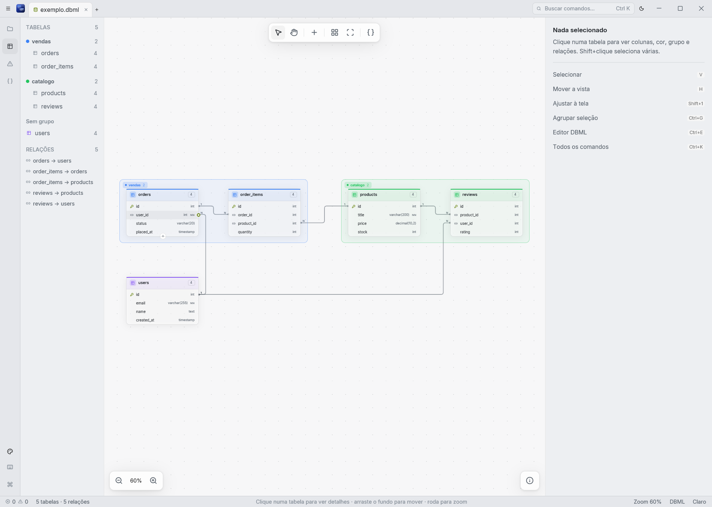

# DB Modeling

**Modele bancos de dados no canvas ou no texto — os dois são a mesma coisa.**

App desktop nativo para **Windows e Ubuntu**, escrito em **Rust + GPUI**.
Na linha do dbdiagram.io, DrawSQL e Azimutt, com foco total em UI/UX.

## O que é

Ferramentas de modelagem costumam ser **texto primeiro** (o diagrama é só um preview) ou
**UI primeiro** (lentas, cheias de modais, ruins de versionar). O DB Modeling junta as duas:

- **Schema em DBML**, um texto legível que versiona bem em git.
- **Canvas de primeira classe**: tabelas, colunas e relações editáveis direto no diagrama.
- **Edição bidirecional**: mexer num lado atualiza o outro, e suas edições viram patches
  mínimos no texto, preservando comentários e formatação.
- **Rápido, offline e nativo**, com teclado primeiro e command palette (`Ctrl+K`).

Sem conexão com banco e sem SQL: o foco é o visual.

## Em ação

### Texto e canvas lado a lado

O editor DBML abre ao lado do canvas (`Ctrl+E`) e as duas visões ficam sempre sincronizadas.

### Tema claro e escuro

### O que já aparece nas imagens

- Tabelas com PK, FK, tipos e `NOT NULL`, e relações roteadas com cardinalidade (1 / N).
- **Grupos** coloridos (`TableGroup`) e painel lateral com tabelas, relações e diagnósticos.
- Barra de ferramentas (selecionar, mover, nova tabela, auto-layout, ajustar à tela), zoom e painel de propriedades.
- Editor DBML com realce de sintaxe e contagem de erros e avisos na barra de status.

> Em desenvolvimento: export **PNG, JPEG e Mermaid `erDiagram`**, múltiplas vistas, sugestões
> inteligentes e instaladores. Veja o [roadmap](docs/06-roadmap.md).

## Como buildar e usar

Toolchain fixada em `rust-toolchain.toml` (rustc 1.99.1); o `rustup` a instala sozinho.

| Objetivo | Comando |
|---|---|
| Rodar o app (Linux) | `cargo run -p app` |
| Build release | `cargo build --release -p app` |
| Testes do núcleo | `cargo test --workspace` |
| Lint / formatação | `cargo clippy --workspace` · `cargo fmt --all` |
| `.exe` Windows (cross, do WSL) | `scripts/build-windows.sh` (requer `cargo-xwin`; copia para o Desktop do Windows) |

- **Ubuntu 22.04/24.04:** o GPUI precisa dos headers de Vulkan, X11/xkbcommon, Wayland e
  fontconfig/freetype (lista exata em [docs/04-stack.md](docs/04-stack.md)). Roda em Wayland e X11.
- **WSL2:** compila normalmente, mas rodar o GPUI no WSLg ainda não foi validado (risco R1).
- **Perfil dev:** já vem com `opt-level = 1` (dependências em 3); sem isso o GPUI fica muito lento.
- **Instaladores** (`.deb`/AppImage/MSI): planejados, ainda não existem.

## Documentação

| Documento | Conteúdo |
|---|---|
| [docs/01-visao.md](docs/01-visao.md) | Problema, público, diferenciais, princípios de UX |
| [docs/02-linguagem.md](docs/02-linguagem.md) | DBML vs linguagem própria vs outras; recomendação |
| [docs/03-arquitetura.md](docs/03-arquitetura.md) | Workspace de crates, modelo de dados, sincronização texto↔UI |
| [docs/04-stack.md](docs/04-stack.md) | Bibliotecas propostas, versões e justificativas |
| [docs/05-ux.md](docs/05-ux.md) | Fluxos de interação: canvas, edição só por UI, atalhos |
| [docs/06-roadmap.md](docs/06-roadmap.md) | Fases, MVP e spikes técnicos |
| [docs/07-skills.md](docs/07-skills.md) | Skills/ferramentas para desenvolvimento assistido (Claude Code) |
| [docs/08-agentes.md](docs/08-agentes.md) | Agentes e roteamento de modelos por tipo de atividade |
| [openspec/adr/](openspec/adr/) | Registro de decisões (ADRs), um arquivo por decisão |
| [GLOSSARY.md](GLOSSARY.md) | Vocabulário do domínio |
| [docs/riscos.md](docs/riscos.md) | Riscos técnicos e perguntas em aberto |
